  

  <strong>Linux • Web Development • Android Applications</strong> 
  Praktyczne narzędzia, projekty webowe i eksperymenty z Androidem.

  
  
  
  

---

## 👨‍💻 O mnie

Interesuję się tworzeniem oprogramowania, środowiskiem Linux oraz budowaniem rozwiązań, które są użyteczne zarówno na komputerze, jak i na urządzeniach mobilnych. Pracuję m.in. z **Termuxem**, narzędziami wiersza poleceń, technologiami webowymi i projektami Android.

Lubię poznawać działanie systemów od środka, automatyzować powtarzalne zadania i rozwijać własne projekty — od koncepcji, przez kod, po konfigurację i testowanie.

## 🧰 Technologie i narzędzia

  
  
  
  
   
  
  
  
  
   
  
  
  

## 🖥️ Obszary, nad którymi pracuję

- **Linux i terminal** — praca z wierszem poleceń, środowiskiem Termux oraz skryptami Shell.
- **Serwery i zdalna administracja** — podstawowa obsługa VPS, połączenia SSH i praca z plikami na serwerze.
- **Tworzenie witryn** — struktura stron w HTML, style CSS oraz rozwijanie własnych stron i interfejsów.
- **Android** — rozwijanie projektów aplikacji i poznawanie procesu budowania pakietów APK.
- **Automatyzacja** — eksperymenty z GitHub Actions i usprawnianie powtarzalnych zadań.

## 🚀 Faller’OS

**Faller’OS** to mój projekt koncepcyjny webowego systemu operacyjnego, który ma działać bezpośrednio w przeglądarce. Celem jest stworzenie interfejsu przypominającego klasyczny pulpit: z oknami, ikonami, menu aplikacji i wygodną obsługą także na urządzeniach mobilnych.

Planowane i rozwijane elementy projektu obejmują:

- pulpit z oknami i uruchamianiem aplikacji,
- menedżer plików oraz organizowanie plików i folderów,
- edytor tekstu, terminal i kalkulator,
- odtwarzanie multimediów i przeglądanie zdjęć,
- personalizację wyglądu oraz proste gry,
- lokalne zapisywanie danych, tak aby ustawienia i pliki mogły przetrwać odświeżenie strony.

Projekt jest rozwijany etapami. Szczegóły, aktualny kod i postęp można sprawdzić w repozytorium:

  
  

## 📌 Moje projekty

| Projekt | Opis |
|---|---|
| [FallerOS-Android](https://github.com/Remo-Faller/FallerOS-Android) | Projekt związany z wersją Android i procesem budowania aplikacji. |
| [Specnaz](https://github.com/Remo-Faller/Specnaz) | Projekt narzędziowy rozwijany z myślą o środowisku Termux. |
| [Remo-Faller.github.io](https://github.com/Remo-Faller/Remo-Faller.github.io) | Moja witryna internetowa. |

## 📫 Kontakt

  
  

Tworzę, testuję i rozwijam kolejne pomysły — krok po kroku.

